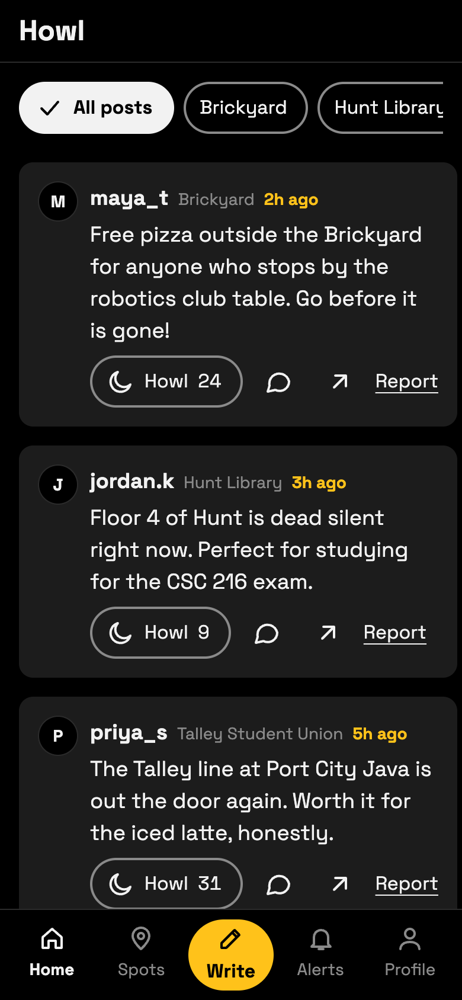
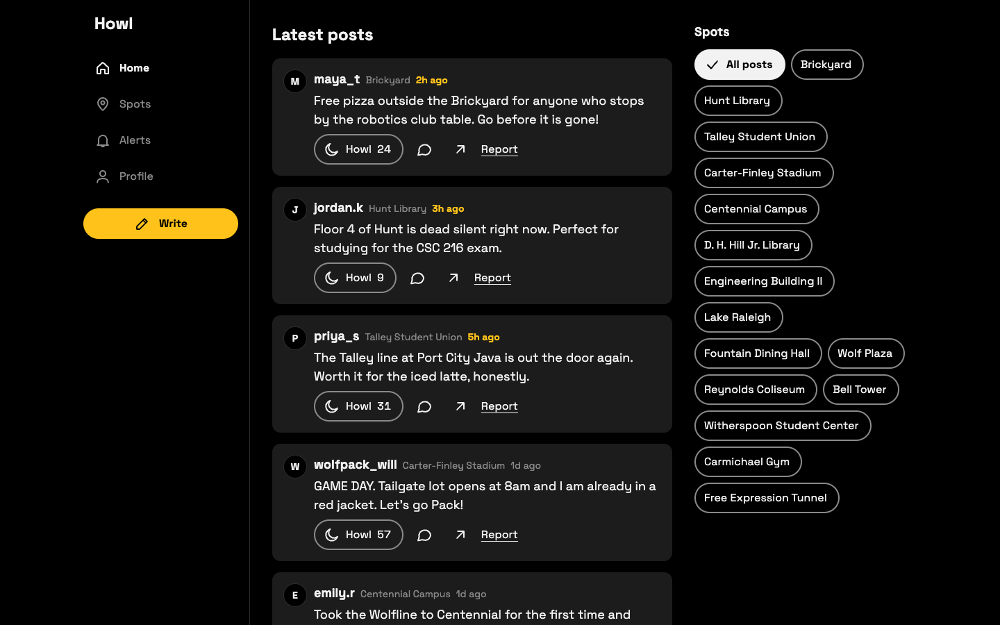

# Howl: a late-night feed for NC State

**Role:** Product designer and builder
**Live:** https://howl-test.vercel.app

## The problem

Campus life happens in small moments: free pizza at the Brickyard, a silent floor at Hunt Library, a long line at Talley. Those moments get lost in big group chats and general social apps. Students needed one quick place for short posts about what's happening on campus.

## How I explored

I ran two rounds of explorations. Round 1 had three directions: a loud red one with a giant wordmark, a late-night black-and-amber one, and a heavy "Howl bar." The loud one gave me the reaction idea, and the late-night one gave me the base. The heavy one was too much, so I dropped it.

Round 2 combined them: the black-and-amber base, with the reaction as a pill and post text raised to 18px. I chose that version because it was loud and fun but still easy to read.

## The design system

The direction is a late-night feed where the newest posts glow. Type does the work: Space Grotesk in two weights, with no campus drawings or decoration. NC State red is the only accent, spent on fresh times, the main buttons and pressed states. I started with amber, then switched to the school's own red so Howl feels like it belongs to the Wolfpack.

I turned this into design tokens for color, type, spacing and shape, in light and dark mode. The code is the main copy, and I brought the variables into Figma. A private page shows every color, text style and component state in both modes. I measured every text and background pair against WCAG AA contrast, in dark mode as well as light. That check caught main buttons showing black text on red, which I fixed.

Motion stays quiet: posts fade in one after another, the Howl button pops and the moon tilts, and everything stops for people who turn on Reduce Motion.

## What I built

- A responsive home screen: tab bar on phones, a side rail on tablets, three columns on laptops.
- A working feed, newest first, with the person, time, howl count and comment count.
- Posting up to 280 characters, with a counter and a friendly hint.
- Howling, Howl's own version of a like: one per person per post, with a clear "Howled" state.
- A page for every post, with comments, and a share button that opens the phone's share sheet.
- Photos on posts, with a required description for screen readers. Photos shrink on the phone before upload, and sample posts use real campus photos with credits.
- Campus events, with an "I'm going" button and the next three events beside the feed on a laptop.
- Reporting: a post is hidden after 3 reports.
- A link preview image and a small icon, so shared links look right in group chats.

All loading and saving lives in one file, so a real database can replace the sample data later.

## What I'd do next

- Connect a real database and accounts, so posts, howls and reports are shared between students.
- Add replies, which the post card already has a button for.
- Test with real NC State students and learn which events they care about most.
- Add moderation tools for reported posts.
- Let student groups add their own events.
